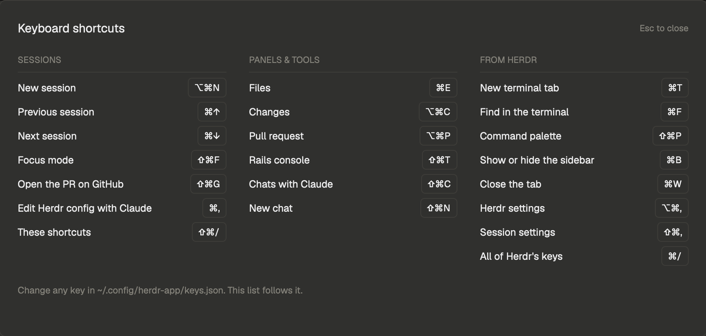

# Firehouse

Firehouse is a Herdr setup for running many Claude Code sessions on one repo at the same time. Each task gets its own git worktree and its own Claude. The sidebar shows which session needs you. Claude fixes the CI failures, conflicts and review comments on its own pull requests, and a session cleans itself up after its pull request merges.

## Start a task in one keystroke

- **New session.** `⌘N` takes a prompt and starts Claude in its own worktree and branch, so tasks never wait on each other.
- **Spin-offs.** The `firehouse:spin-off` skill turns a side task into a new session while the first one keeps going.

## See what needs you

- **Sidebar.** Sessions are grouped by repo and marked working, blocked or done.
- **Focus mode.** `⇧⌘F` shows only the sessions you starred and mutes the rest.
- **Snooze.** A session hides until tomorrow or next week, then comes back.

## Pull requests that finish themselves

The Pull request panel (`⌥⌘P`) shows the session's checks and reviews, and has three toggles.

- **Fix.** Claude fixes failed CI, merge conflicts and review comments on its own, and asks you after 5 rounds.
- **Merge.** Firehouse puts the pull request in the merge queue once it's ready.
- **Settle.** After the pull request merges, the session moves to Settled, and its worktree goes away after 7 days. The branch stays.

## Everything else

- **Tools beside Claude.** Files in Neovim, Changes in lazygit and a Rails console open in the session's worktree.
- **Chats.** `⇧⌘C` holds questions that belong to no repo, and each chat names itself.
- **Reviews.** `⇧⌘R` lists the pull requests that ask for your review, with diffs, threads and Review changes inside Herdr.
- **Check out.** One click opens a pull request's branch in a new focus session.
- **Custom commands.** Your own shell commands go in the command palette and stay on your machine.
- **Settings.** `⇧⌘,` sets the branch prefix, settling, focus mode, snooze time, reviews and the model for text generation.
- **Change it with Claude.** `⌘,` opens Claude in this repo to change the setup itself.

`⇧⌘/` shows every shortcut.



## Install

Paste this into Claude Code:

```
Read ~/.config/herdr-app/AGENTS.md, then add this layout: https://github.com/frodsan/dotfiles/tree/master/.config/herdr-app
Also copy https://github.com/frodsan/dotfiles/tree/master/.claude/skills/firehouse to ~/.claude/skills/firehouse.
```
