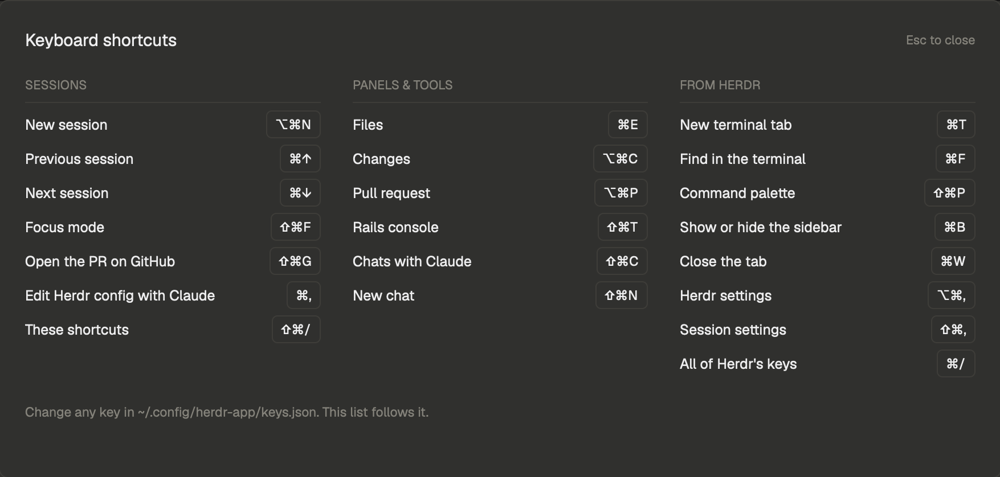

# Herdr mods

The Firehouse layout uses these mods. `install.sh` links each folder into `~/.config/herdr-app/mods/`. Keys come from `../keys.json`.

## sessions

The sidebar and most of the workflow. One session is one Herdr space, usually a git worktree with Claude running in it.

- Session list. Groups sessions by folder, with Working, Snoozed and Settled groups. Right-click a session for its menu, or a folder to set the setup command for its new worktrees.
- New session (`⌥⌘N`). Creates a worktree and a branch, runs the folder's setup command and starts Claude with your prompt.
- Focus mode (`⇧⌘F`). Shows only the sessions you starred or pinned, and mutes sounds. Snooze a session until a set time.
- Previous and next session (`⌘↑`, `⌘↓`).
- Tab bar. Opens Files (`⌘E`, nvim), Changes (`⌥⌘C`, lazygit), Rails console (`⇧⌘T`) and the Pull request panel (`⌥⌘P`) for the session. `⇧⌘G` opens the pull request on GitHub.
- Pull request panel. Shows checks and reviews, updates the branch, and has three toggles. Merge turns on auto-merge. Fix runs auto-fix, where Claude fixes CI failures, conflicts and review comments. Settle archives the session when the pull request merges or closes.
- Auto-fix also notifies you when someone reacts 👎 to a reply labeled `[AI-generated]`.
- Settling. Archives a finished session, and deletes its worktree and Claude conversation after the number of days set in the settings.
- Spin-offs. Starts a side task as a new session from a brief that the `herdr:spin-off` skill writes.
- Session settings (`⇧⌘,`, or the gear in the sidebar header). Branch prefix, settling, focus mode, snooze times and toasts. The code is in `sessions/settings.js`.
- Edit Herdr config with Claude (`⌘,`). Opens a Claude session in the dotfiles repo.
- Welcome. A dialog on first start that checks the tools and skills the mods need.
- Sidebar extensions. Another mod can add a sidebar icon and view with a `sidebar.json` file in its folder.

## chats

Claude conversations that belong to no repo. They run in `~/.config/herdr-app/data/chats/workspace`.

- Chats list (`⇧⌘C`, or the chat icon in the sidebar header). Swaps the session list for the chats list.
- New chat (`⇧⌘N`). Starts a chat in its own space and names it after the conversation.

## custom-commands

Your own commands in the command palette. Each one opens a terminal on the right that runs a shell command.

- Edit them from the palette with "Edit custom commands…".
- The list is in the shared key `commands.list`, so it stays on this machine.
- The mod writes the palette entries into a generated mod, `custom-commands-local`.
- The layout needs a block for this mod, even a 0px one, so that it runs and publishes the entries.

## shortcuts

The keyboard shortcuts dialog (`⇧⌘/`). It reads `keys.json`, so it shows the keys you set.

